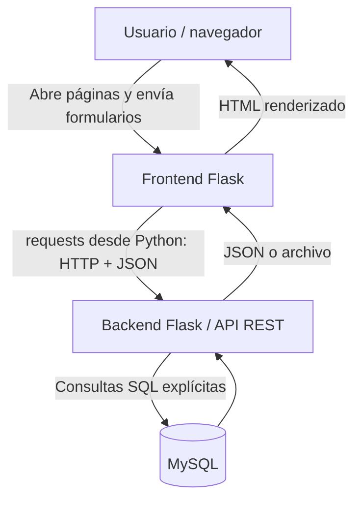

# Cine Paradiso — Rutas del Frontend y endpoints del Backend

## Arquitectura general

### Convenciones

- En este documento, el Frontend corre como ejemplo en `http://localhost:5001` y el Backend en `http://localhost:5000`. Los puertos pueden cambiar.
- El prefijo `/api` identifica las rutas del Backend
---

# 1. Autenticación y usuarios

## 1.1 Rutas del Frontend

| Método | Ruta del Frontend            | Qué hace                                                                                  | Llamada al Backend                                                                                 |
| ------ | ---------------------------- | ----------------------------------------------------------------------------------------- | -------------------------------------------------------------------------------------------------- |
| GET    | `/login`                     | Muestra el formulario de inicio de sesión.                                                | No necesita una llamada para mostrar el formulario.                                                |
| POST   | `/login`                     | Envía las credenciales y establece la sesión del lado del Frontend si el login es válido. | `POST /api/auth/login`                                                                             |
| GET    | `/registro`                  | Muestra el formulario de registro.                                                        | No necesita una llamada para mostrar el formulario.                                                |
| POST   | `/registro`                  | Envía los datos para crear una cuenta de cliente.                                         | `POST /api/auth/registro`                                                                          |
| POST   | `/logout`                    | Cierra la sesión del Frontend.                                                            | `POST /api/auth/logout`, si el mecanismo elegido requiere invalidar la sesión/token en el Backend. |
| GET    | `/mi-cuenta`                 | Muestra el resumen de la cuenta.                                                          | `GET /api/usuarios/me`                                                                             |
| GET    | `/mi-cuenta/perfil`          | Muestra el perfil del usuario.                                                            | `GET /api/usuarios/me`                                                                             |
| POST   | `/mi-cuenta/perfil`          | Envía los cambios del perfil.                                                             | `PATCH /api/usuarios/me`                                                                           |
| POST   | `/mi-cuenta/perfil/password` | Envía el cambio de contraseña.                                                            | `PATCH /api/usuarios/me/password`                                                                  |
| GET    | `/mi-cuenta/historial`       | Muestra compras, entradas y consumos anteriores.                                          | `GET /api/usuarios/me/historial`                                                                   |

## 1.2 Endpoints del Backend

| Método    | Endpoint                     | Acceso              | Qué hace                                                                                    |
| --------- | ---------------------------- | ------------------- | ------------------------------------------------------------------------------------------- |
| POST      | `/api/auth/registro`         | Público             | Crea una cuenta con rol `cliente`; nunca debe permitir que el público cree administradores. |
| POST      | `/api/auth/login`            | Público             | Valida las credenciales y crea la sesión o devuelve el token acordado.                      |
| POST      | `/api/auth/logout`           | Autenticado         | Invalida la sesión/token si la estrategia de autenticación lo contempla.                    |
| GET       | `/api/usuarios/me`           | Cliente autenticado | Devuelve el perfil propio.                                                                  |
| PATCH     | `/api/usuarios/me`           | Cliente autenticado | Modifica los datos del perfil propio.                                                       |
| PATCH     | `/api/usuarios/me/password`  | Cliente autenticado | Cambia la contraseña; almacena solamente su hash.                                           |
| GET       | `/api/usuarios/me/historial` | Cliente autenticado | Devuelve el historial propio de compras, entradas y consumos.                               |

---

# 2. Backoffice

El Backoffice reúne las pantallas administrativas. Los endpoints concretos para administrar películas, funciones, salas y servicios aparecen en los módulos correspondientes más abajo.

## 2.1 Rutas del Frontend

| Método | Ruta del Frontend                                | Qué hace                                              | Llamada al Backend                                       |
| ------ | ------------------------------------------------ | ----------------------------------------------------- | -------------------------------------------------------- |
| GET    | `/admin`                                         | Muestra la página principal del panel administrativo. | Puede consultar uno o varios endpoints de estadísticas.  |
| GET    | `/admin/usuarios`                                | Lista los usuarios para administrarlos.               | `GET /api/admin/usuarios`                                |
| GET    | `/admin/usuarios/<id>/editar`                    | Carga los datos de un usuario para el formulario.     | `GET /api/admin/usuarios/<id>`                           |
| POST   | `/admin/usuarios/<id>/editar`                    | Envía cambios de rol o estado.                        | `PATCH /api/admin/usuarios/<id>`                         |
| GET    | `/admin/estadisticas`                            | Muestra el panel de dashboards.                       | Consulta los endpoints de estadísticas listados abajo.   |
| GET    | `/admin/estadisticas/ocupacion?agrupar=funcion`  | Muestra ocupación por función.                        | `GET /api/admin/estadisticas/ocupacion?agrupar=funcion`  |
| GET    | `/admin/estadisticas/ocupacion?agrupar=pelicula` | Muestra ocupación por película.                       | `GET /api/admin/estadisticas/ocupacion?agrupar=pelicula` |
| GET    | `/admin/estadisticas/ventas-por-genero`          | Muestra ventas agrupadas por género.                  | `GET /api/admin/estadisticas/ventas-por-genero`          |
| GET    | `/admin/estadisticas/franjas-horarias`           | Muestra los horarios más vendidos.                    | `GET /api/admin/estadisticas/franjas-horarias`           |
| GET    | `/admin/estadisticas/cancelaciones`              | Muestra datos de cancelaciones.                       | `GET /api/admin/estadisticas/cancelaciones`              |

## 2.2 Endpoints del Backend

| Método | Endpoint                                             | Acceso        | Qué hace                                                           |
| ------ | ---------------------------------------------------- | ------------- | ------------------------------------------------------------------ |
| GET    | `/api/admin/usuarios`                                | Administrador | Lista usuarios para administración.                                |
| GET    | `/api/admin/usuarios/<id>`                           | Administrador | Devuelve los datos necesarios para abrir la edición de un usuario. |
| PATCH  | `/api/admin/usuarios/<id>`                           | Administrador | Modifica el rol o estado de un usuario.                            |
| GET    | `/api/admin/estadisticas/ocupacion?agrupar=funcion`  | Administrador | Devuelve la ocupación por función.                                 |
| GET    | `/api/admin/estadisticas/ocupacion?agrupar=pelicula` | Administrador | Devuelve la ocupación agrupada por película.                       |
| GET    | `/api/admin/estadisticas/ventas-por-genero`          | Administrador | Devuelve las ventas agrupadas por género.                          |
| GET    | `/api/admin/estadisticas/franjas-horarias`           | Administrador | Devuelve las franjas horarias más vendidas.                        |
| GET    | `/api/admin/estadisticas/cancelaciones`              | Administrador | Devuelve cantidades y datos de cancelaciones.                      |

---

# 3. Locales, salas y butacas

## 3.1 Rutas del Frontend

| Método | Ruta del Frontend               | Qué hace                                                      | Llamada al Backend                                  |
| ------ | ------------------------------- | ------------------------------------------------------------- | --------------------------------------------------- |
| GET    | `/locales`                      | Muestra los locales disponibles para elegir dónde ir al cine. | `GET /api/locales`                                  |
| GET    | `/admin/locales`                | Muestra los locales en el Backoffice.                         | `GET /api/locales`                                  |
| GET    | `/admin/salas`                  | Lista las salas para administrarlas.                          | `GET /api/salas`                                    |
| GET    | `/admin/salas/nueva`            | Muestra el formulario de creación de sala.                    | No necesita una llamada para mostrar el formulario. |
| POST   | `/admin/salas/nueva`            | Envía el formulario para crear la sala.                       | `POST /api/salas`                                   |
| PATCH  | `/admin/locales/<id>/editar`    |                                                               | No necesita una llamada para mostrar el formulario. |
| GET    | `/admin/salas/<id>/editar`      | Muestra el formulario para editar una sala.                   | `GET /api/salas/<id>`                               |
| POST   | `/admin/salas/<id>/editar`      | Envía los cambios de la sala.                                 | `PATCH /api/salas/<id>`                             |
| POST   | `/admin/salas/<id>/dar-de-baja` | Solicita dar de baja una sala.                                | `DELETE /api/salas/<id>`                            |

## 3.2 Endpoints del Backend

| Método | Endpoint                  | Acceso        | Qué hace                                                                                  |
| ------ | ------------------------- | ------------- | ----------------------------------------------------------------------------------------- |
| GET    | `/api/locales`            | Público       | Lista los locales activos.                                                                |
| GET    | `/api/locales/<id>/salas` | Público       | Lista las salas activas de un local.                                                      |
| GET    | `/api/salas`              | Administrador | Lista las salas para el Backoffice; puede aceptar filtros por local.                      |
| GET    | `/api/salas/<id>`         | Público       | Devuelve el detalle y la capacidad de una sala.                                           |
| GET    | `/api/salas/<id>/butacas` | Público       | Devuelve las butacas físicas de la sala, sin determinar si están ocupadas en una función. |
| POST   | `/api/salas`              | Administrador | Crea una sala y configura o genera sus butacas físicas.                                   |
| PATCH  | `/api/salas/<id>`         | Administrador | Modifica los datos de una sala.                                                           |
| DELETE | `/api/salas/<id>`         | Administrador | Da de baja una sala. Se recomienda baja lógica si tiene funciones históricas.             |

---

# 4. Películas y cartelera

## 4.1 Rutas del Frontend

| Método | Ruta del Frontend                            | Qué hace                                                                                  | Llamada al Backend                                                                                                                                                                        |
| ------ | -------------------------------------------- | ----------------------------------------------------------------------------------------- | ----------------------------------------------------------------------------------------------------------------------------------------------------------------------------------------- |
| GET    | `/`                                          | Página de inicio; puede redirigir a la cartelera.                                         | `GET /api/cartelera`  muestra películas en la página inicial. `GET /api/productos` para mostrar los productos.  `GET /api/promociones` muestra las promociones en la pagina inicial |
| GET    | `/peliculas`                                 | Muestra la cartelera pública. Puede aceptar filtros de búsqueda.                          | `GET /api/peliculas` muestra las peliculas vigentes                                                                                                                                       |
| GET    | `/peliculas/<id>`                            | Muestra el detalle de una película y sus funciones disponibles.                           | `GET /api/peliculas/<id>`                                                                                                                                                                 |
| GET    | `/admin/peliculas`                           | Lista películas para administrarlas, incluidas las que no están actualmente en cartelera. | `GET /api/admin/peliculas`                                                                                                                                                                |
| GET    | `/admin/peliculas/buscar-externas?q=<texto>` | Busca títulos en TMDB u OMDb.                                                             | `GET /api/catalogo-externo/peliculas?q=<texto>`                                                                                                                                           |
| GET    | `/admin/peliculas/nueva`                     | Muestra el formulario para cargar una película.                                           | No necesita una llamada para mostrar el formulario.                                                                                                                                       |
| POST   | `/admin/peliculas/nueva`                     | Envía el formulario para incorporar una película.                                         | `POST /api/peliculas`                                                                                                                                                                     |
| GET    | `/admin/peliculas/<id>/editar`               | Muestra la información para editar una película.                                          | `GET /api/peliculas/<id>`                                                                                                                                                                 |
| POST   | `/admin/peliculas/<id>/editar`               | Envía los cambios de una película.                                                        | `PATCH /api/peliculas/<id>`                                                                                                                                                               |
| POST   | `/admin/peliculas/<id>/dar-de-baja`          | Solicita dar de baja una película sin borrar el historial.                                | `DELETE /api/peliculas/<id>`                                                                                                                                                              |

## 4.2 Endpoints del Backend

| Método | Endpoint                                    | Acceso        | Qué hace                                                                                     |
| ------ | ------------------------------------------- | ------------- | -------------------------------------------------------------------------------------------- |
| GET    | `/api/peliculas`                            | Público       | Devuelve las películas vigentes en cartelera; puede admitir género u otros filtros.          |
| GET    | /api/cartelera                              | publico       | muestra las peliculas en la pagina principal                                                 |
| GET    | `/api/peliculas/<id>`                       | Público       | Devuelve los datos de una película.                                                          |
| GET    | `/api/admin/peliculas`                      | Administrador | Lista el catálogo completo para la administración, incluso las películas fuera de cartelera. |
| GET    | `/api/catalogo-externo/peliculas?q=<texto>` | Administrador | Busca películas en la API externa seleccionada, como TMDB u OMDb.                            |
| POST   | `/api/peliculas`                            | Administrador | Guarda una película en el catálogo propio.                                                   |
| PATCH  | `/api/peliculas/<id>`                       | Administrador | Modifica sus datos o el período de cartelera.                                                |
| DELETE | `/api/peliculas/<id>`                       | Administrador | Da de baja una película; preferiblemente de manera lógica si tiene historial.                |

---

# 5. Funciones

## 5.1 Rutas del Frontend

| Método | Ruta del Frontend                                                                              | Qué hace                                                       | Llamada al Backend                                                          |
| ------ | ---------------------------------------------------------------------------------------------- | -------------------------------------------------------------- | --------------------------------------------------------------------------- |
| GET    | `/funciones?pelicula_id=<id>&local_id=<id>&fecha=<fecha>`                                      | Muestra funciones filtradas por película, local o fecha.       | `GET /api/funciones?pelicula_id=<id>&local_id=<id>&fecha=<fecha>`           |
| GET    | `/funciones/<id>/butacas` o `/funciones/?pelicula_id=<id>&local_id=<id>&fecha=<fecha>/butacas` | Muestra el mapa de butacas libres y ocupadas para esa función. | `GET /api/funciones/<id>/butacas`                                           |
| GET    | `/admin/funciones`                                                                             | Lista las funciones configuradas en el Backoffice.             | `GET /api/funciones`                                                        |
| GET    | `/admin/funciones/nueva`                                                                       | Muestra el formulario para crear una función.                  | Puede cargar películas, locales y salas con los endpoints correspondientes. |
| POST   | `/admin/funciones/nueva`                                                                       | Envía los datos para crear una función.                        | `POST /api/funciones`                                                       |
| GET    | `/admin/funciones/<id>/editar`                                                                 | Muestra el formulario de edición.                              | `GET /api/funciones/<id>`                                                   |
| POST   | `/admin/funciones/<id>/editar`                                                                 | Envía las modificaciones de una función.                       | `PATCH /api/funciones/<id>`                                                 |
| POST   | `/admin/funciones/<id>/cancelar`                                                               | Solicita cancelar una función.                                 | `PATCH /api/funciones/<id>` con estado `cancelada`.                         |

## 5.2 Endpoints del Backend

| Método | Endpoint                      | Acceso                                        | Qué hace                                                                      |
| ------ | ----------------------------- | --------------------------------------------- | ----------------------------------------------------------------------------- |
| GET    | `/api/funciones`              | Público o autenticado, según acuerde el grupo | Busca funciones por película, local y fecha.                                  |
| GET    | `/api/funciones/<id>`         | Público o autenticado, según acuerde el grupo | Devuelve los datos de una función.                                            |
| GET    | `/api/funciones/<id>/butacas` | Público o autenticado, según acuerde el grupo | Devuelve las butacas y su disponibilidad para esa función.                    |
| POST   | `/api/funciones`              | Administrador                                 | Crea una función y valida que la sala no tenga un solapamiento horario.       |
| PATCH  | `/api/funciones/<id>`         | Administrador                                 | Modifica horario, sala o estado; debe considerar si ya hay entradas vendidas. |

---

# 6. Compras, servicios y checkout

## 6.1 Rutas del Frontend

| Método | Ruta del Frontend                   | Qué hace                                                                             | Llamada al Backend                                                                                               |
| ------ | ----------------------------------- | ------------------------------------------------------------------------------------ | ---------------------------------------------------------------------------------------------------------------- |
| GET    | `/servicios`                        | Muestra los servicios adicionales disponibles, si hay una pantalla específica.       | `GET /api/servicios`                                                                                             |
| GET    | `/checkout`                         | Muestra el resumen previo a confirmar: función, butacas, servicios y total estimado. | `GET /api/funciones/<id>`, `GET /api/funciones/<id>/butacas` y `GET /api/servicios`, según los datos que falten. |
| POST   | `/checkout`                         | Envía la confirmación de compra.                                                     | `POST /api/compras`                                                                                              |
| GET    | `/mi-cuenta/compras`                | Muestra las compras del usuario.                                                     | `GET /api/compras`                                                                                               |
| GET    | `/mi-cuenta/compras/<id>`           | Muestra el detalle de una compra propia.                                             | `GET /api/compras/<id>`                                                                                          |
| POST   | `/mi-cuenta/compras/<id>/cancelar`  | Solicita cancelar una compra.                                                        | `POST /api/compras/<id>/cancelacion`                                                                             |
| GET    | `/mi-cuenta/compras/<id>/factura`   | Muestra o descarga la factura.                                                       | `GET /api/compras/<id>/factura`                                                                                  |
| GET    | `/mi-cuenta/entradas/<id>/qr`       | Muestra o descarga el QR de una entrada propia.                                      | `GET /api/entradas/<id>/qr`                                                                                      |
| GET    | `/admin/servicios`                  | Lista servicios para administrarlos.                                                 | `GET /api/servicios?incluir_inactivos=true` (solo para administrador).                                           |
| GET    | `/admin/servicios/nuevo`            | Muestra el formulario para crear un servicio.                                        | No necesita una llamada para mostrar el formulario.                                                              |
| POST   | `/admin/servicios/nuevo`            | Envía los datos de un nuevo servicio.                                                | `POST /api/servicios`                                                                                            |
| GET    | `/admin/servicios/<id>/editar`      | Carga los datos de un servicio.                                                      | `GET /api/servicios/<id>`                                                                                        |
| POST   | `/admin/servicios/<id>/editar`      | Envía los cambios del servicio.                                                      | `PATCH /api/servicios/<id>`                                                                                      |
| POST   | `/admin/servicios/<id>/dar-de-baja` | Solicita dar de baja un servicio.                                                    | `DELETE /api/servicios/<id>`                                                                                     |

## 6.2 Endpoints del Backend: compras y checkout

| Método | Endpoint                        | Acceso                                               | Qué hace                                                                                                                                 |
| ------ | ------------------------------- | ---------------------------------------------------- | ---------------------------------------------------------------------------------------------------------------------------------------- |
| POST   | `/api/compras`                  | Cliente autenticado                                  | Registra una compra con una función, butacas y servicios opcionales. El Backend calcula el total y vuelve a comprobar la disponibilidad. |
| GET    | `/api/compras`                  | Cliente autenticado                                  | Lista únicamente las compras del cliente autenticado.                                                                                    |
| GET    | `/api/compras/<id>`             | Propietario de la compra o administrador autorizado  | Devuelve el detalle de esa compra.                                                                                                       |
| POST   | `/api/compras/<id>/cancelacion` | Propietario de la compra                             | Cancela si cumple el plazo y las reglas; conserva el historial y libera las butacas de forma consistente.                                |
| GET    | `/api/compras/<id>/factura`     | Propietario de la compra o administrador autorizado  | Devuelve o genera la factura de la compra.                                                                                               |
| GET    | `/api/entradas/<id>/qr`         | Propietario de la entrada o administrador autorizado | Devuelve el QR de una entrada individual.                                                                                                |
| POST   | `/api/compras/<id>/servicios`   | Propietario de la compra                             | Agrega servicios a una compra ya realizada. **Opcional**, solo si deciden permitir esa operación.                                        |

## 6.3 Endpoints del Backend: servicios

| Método | Endpoint              | Acceso        | Qué hace                                                                                                        |
| ------ | --------------------- | ------------- | --------------------------------------------------------------------------------------------------------------- |
| GET    | `/api/servicios`      | Público       | Lista servicios activos y sus precios. Un parámetro para ver inactivos debe estar restringido al administrador. |
| GET    | `/api/servicios/<id>` | Administrador | Devuelve el detalle de un servicio para editarlo.                                                               |
| POST   | `/api/servicios`      | Administrador | Crea un servicio.                                                                                               |
| PATCH  | `/api/servicios/<id>` | Administrador | Modifica los datos o el precio del servicio.                                                                    |
| DELETE | `/api/servicios/<id>` | Administrador | Da de baja un servicio sin borrar las compras históricas.                                                       |
| GET    | /api/productos        | publico       | Sirve para mostrar los productos en cartelera                                                                   |
| GET    | /api/promociones      | publico       | Sirve para mostrar los promociones en cartelera                                                                 |

---

# 7. Validación de entradas mediante QR

## 7.1 Rutas del Frontend

| Método | Ruta del Frontend                  | Qué hace                                                                 | Llamada al Backend                              |
| ------ | ---------------------------------- | ------------------------------------------------------------------------ | ----------------------------------------------- |
| GET    | `/admin/validar-qr`                | Muestra la pantalla para escanear o introducir un QR.                    | No necesita llamada para mostrar el formulario. |
| POST   | `/admin/funciones/<id>/validar-qr` | Envía el token leído para una función específica y muestra el resultado. | `POST /api/funciones/<id>/validaciones-qr`      |

## 7.2 Endpoint del Backend

| Método | Endpoint                              | Acceso                              | Qué hace                                                                                                                                   |
| ------ | ------------------------------------- | ----------------------------------- | ------------------------------------------------------------------------------------------------------------------------------------------ |
| POST   | `/api/funciones/<id>/validaciones-qr` | Administrador o personal autorizado | Comprueba que el QR corresponde a una entrada de esa función, que no esté cancelada ni utilizada y, si es válido, la marca como utilizada. |
| PATCH  | `/api/funciones/<id>/validaciones-qr` | Administrador                       | Cambia el estado del QR a usado                                                                                                            |

---

# 8. Funcionalidades deseables

## 8.1 Reseñas de películas

Debe haber un chequeo de que el QR de la pelicula fue usado para poder hacer una resena

| Capa     | Método | Ruta                          | Qué hace / acceso                                                                    |
| -------- | ------ | ----------------------------- | ------------------------------------------------------------------------------------ |
| Frontend | GET    | `/peliculas/<id>/resenas`     | Muestra las reseñas de una película.                                                 |
| Frontend | POST   | `/peliculas/<id>/resenas`     | Envía una reseña desde el formulario.                                                |
| Backend  | GET    | `/api/peliculas/<id>/resenas` | Lista reseñas. Puede ser público.                                                    |
| Backend  | POST   | `/api/peliculas/<id>/resenas` | Crea una reseña. Cliente autenticado que haya asistido y tenga una entrada validada. |

## 8.2 Recuperación de contraseña

| Capa     | Método | Ruta                         | Qué hace / acceso                                                                           |
| -------- | ------ | ---------------------------- | ------------------------------------------------------------------------------------------- |
| Frontend | GET    | `/recuperar-contrasena`      | Muestra el formulario para solicitar recuperación.                                          |
| Frontend | POST   | `/recuperar-contrasena`      | Envía el email para iniciar la recuperación.                                                |
| Frontend | GET    | `/restablecer-contrasena`    | Muestra el formulario para definir una nueva contraseña mediante un enlace válido.          |
| Frontend | POST   | `/restablecer-contrasena`    | Envía el token y la nueva contraseña.                                                       |
| Backend  | POST   | `/api/auth/recuperacion`     | Envía un enlace de recuperación con token temporal. Debe evitar revelar si el email existe. |
| Backend  | PATCH  | `/api/auth/restablecimiento` | Valida un token de un solo uso y actualiza el hash de la contraseña.                        |

## 8.3 Reporte PDF de ventas

| Capa     | Método | Ruta                         | Qué hace / acceso                                                                      |
| -------- | ------ | ---------------------------- | -------------------------------------------------------------------------------------- |
| Frontend | GET    | `/admin/reportes/ventas`     | Muestra el acceso o inicia la descarga del informe.                                    |
| Backend  | GET    | `/api/admin/reportes/ventas` | Genera o devuelve un PDF con ventas por función y películas más vistas. Administrador. |

