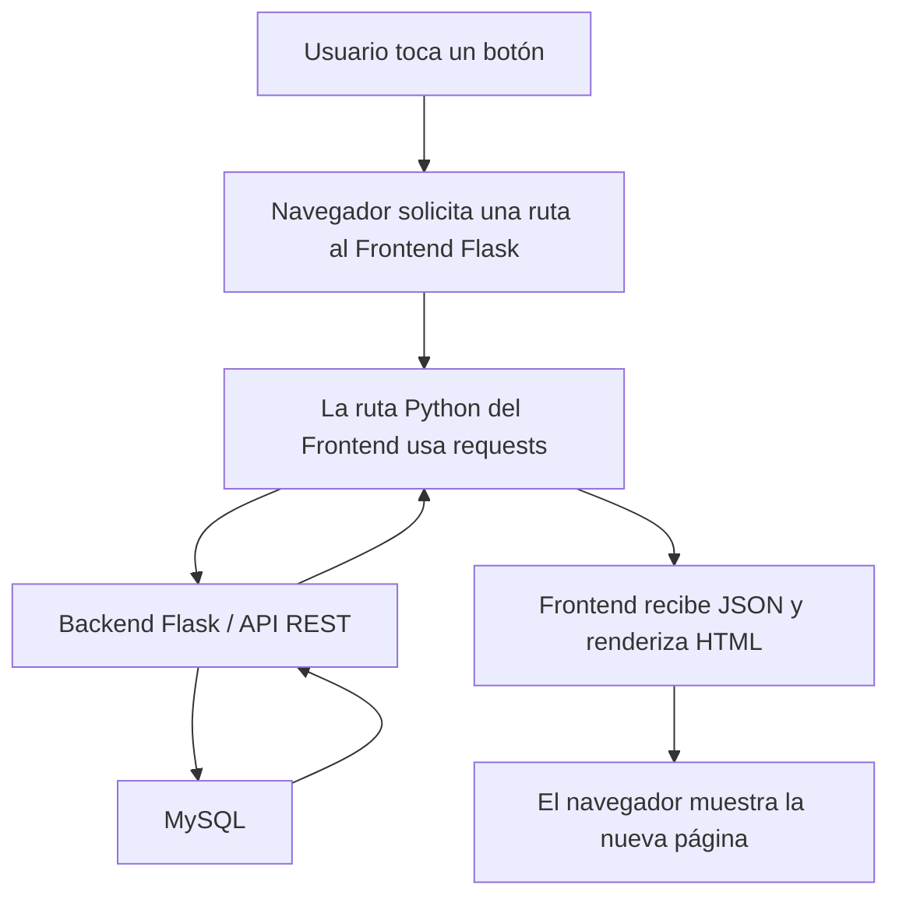

# Cine Paradiso — mapa entre mockups, Frontend y API

## Mapa de notas

- [[01- Supuestos e hipótesis - Cine Paradiso]] — Planteo de ideas, hipotesis y supuestos
- [[02 - Flujo de compra de entradas]] — recorrido completo, desde elegir una película hasta validar el QR.
- [[03- CineParadiso-Endpoints-por-Modulo-Obsidian]] — Endpoints del frontend y del backend
- [[04 - Esquema de tablas]] — Esquema de tablas con sus caracteristicas
## Regla de arquitectura de la materia

## Archivos incluidos

La imagen original compartida por el grupo está en `assets/Mockups-Cine-Paradiso.png`.

![[assets/Mockups-Cine-Paradiso.png]]

## Convenciones que usamos en el ejemplo

- Las rutas `/...` son páginas/formularios del **Frontend Flask**.
- Las rutas `/api/...` son endpoints del **Backend Flask**.

